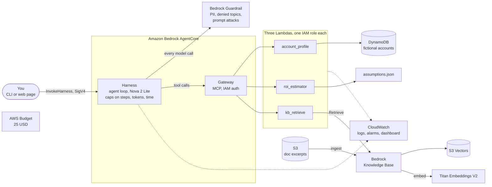

# Discovery Brief & ROI Agent

An AI agent on **Amazon Bedrock AgentCore** that prepares a pre-sales discovery brief in about a minute. You give it a (fictional) company name. It looks up the account, retrieves AWS best practice with source links, estimates a 3-year ROI with a deterministic calculator, and writes a six-section brief. Everything is Terraform, serverless, and costs $0 while idle.

It is also an exercise in doing an AI project the way a customer would need it done: a budget alarm before any spend, least-privilege roles, a measured evaluation including attacks, and honest documentation of what does not work.

> **Synthetic data only.** Five fictional companies, no real customer data. The knowledge base holds 17 short paraphrases of AWS documentation, each with a source link and a check date.

## The problem

Before a first customer meeting, a solutions architect or sales engineer spends hours on the same questions: who are they, what do they run, what will they worry about, what should I ask, what could the cloud save them, and what could go wrong. The agent does a first pass at that, and it is built so that every claim can be traced:

- **Numbers come from code**, not from the model. The ROI tool is plain Python; its assumptions are printed next to the result.
- **Advice comes from retrieved documents** with links, not from memory.
- **"I don't know" is an answer.** An unknown company gets "not in the database", never an invented profile.

## What it produces

```
python client/brief.py "Northwind Logistics"
```

1. **Account summary**
2. **Likely pain points** (inferred ones are labelled)
3. **Nine discovery questions** (business, technical, security, financial)
4. **First-workload architecture**, every bullet linked to a retrieved source
5. **3-year ROI, labelled preliminary**, with all assumptions
6. **Risks and open items**

For Northwind Logistics (4,200 employees, 340 servers, 180 TB, $3.9M a year on infrastructure) the ROI tool returns:

| | 3-year on-prem | 3-year AWS | Savings | ROI | Breakeven |
|---|---|---|---|---|---|
| Northwind Logistics | $13,160,160 | $7,768,676 | $5,391,484 | 69.4% | Year 1 |

That number leans on one judgement call: the share of today's bill that never goes away (staff, licences, network). Moving it from 60% to 30% moves the ROI from about 26% to about 104%. The brief is meant to show that sensitivity, not hide it.

After the brief, the client runs **deterministic checks** against the tool results: every link came from a retrieved passage, every ROI figure is in the tool output, the ROI tool received the profile's real numbers, the section order and question count are right.

## Architecture



One request: the client signs an `InvokeHarness` call with your AWS identity. The harness runs the model in a loop, screening every model call with the guardrail. The model calls the profile tool, searches the knowledge base two or three times, calls the ROI tool once, then writes the brief. Tool calls go through the Gateway, which invokes the three Lambdas. The client then checks the finished brief against what the tools returned.

More detail, with a sequence diagram and a plain-English walkthrough: [docs/project-overview.md](docs/project-overview.md) and [docs/architecture.md](docs/architecture.md).

## Design decisions and trade-offs

The full table (36 decisions, each with the alternatives and "what would change my mind") is in [LEARNING_NOTES.md](LEARNING_NOTES.md). The ones that shaped the build:

| Decision | Instead of | Why | Cost of the choice |
|---|---|---|---|
| **AgentCore** harness and gateway | Bedrock Agents "Classic" | Classic is closed to new accounts (since 2026-07-30); AgentCore is the supported successor | A newer service; some behaviour I had to find by testing |
| **S3 Vectors** for the index | OpenSearch Serverless, Aurora | No hourly floor, about $0.06 per GB-month; the corpus is about 1 MB | Semantic search only: a keyword-heavy question ranked the best document 4th |
| **Nova 2 Lite** as the model | Claude Haiku 4.5 | $0.33 / $2.75 per million tokens against $1.10 / $5.50, no subscription form | It does not reliably follow "only name services you were given" (see the evaluation). The Haiku comparison was not run |
| **Maths in Python**, assumptions in a file | Letting the model calculate | Deterministic, unit-tested, and a CFO can challenge each assumption | The model is simple: no discounting, tax or phased migration |
| **Serverless only** | EC2, containers | $0 idle, so forgetting to tear down costs cents | Not the cheapest at sustained high volume |
| **A `kb_retrieve` Lambda** | The Gateway's built-in knowledge-base connector | The connector supports only Managed Knowledge Bases, a dearer product than the S3 Vectors one | One more function to own |
| **Deterministic checks** on the finished brief | The guardrail's grounding filter | The filter scored a faithful section 0.17 and one with five ungrounded services 0.05, so it could not tell them apart | The checks are blunt and flag some correct names |
| **Mechanical pass/fail rules** in the evaluation | A model as judge | Free, repeatable, cannot disagree with itself | Cannot judge tone or usefulness |
| **Budget alarm in its own stack**, applied first | One stack for everything | It must exist before anything billable and survive `make destroy` | A warning, not a brake: AWS refreshes budgets a few times a day |

## Security model

**Identity.** One IAM role per Lambda and per service, each with a comment explaining every statement. `account_profile` can `GetItem` on one table; `roi_estimator` can only write logs; `kb_retrieve` can `Retrieve` from one knowledge base. The gateway role can invoke exactly three functions and can only be assumed by a gateway in this account with a matching name. The harness role can call one model, apply one guardrail and use one gateway. Callers sign requests with IAM; there are no API keys.

**Content.** Five layers, in order: the guardrail screens what you type; the system prompt limits the agent to briefs; the tools limit what it can do (three tools; the default shell and file tools are switched off by an allow-list); the guardrail screens what it writes; the client checks the finished brief. Eighteen kinds of personal data are blocked, four off-topic subjects are denied, and the prompt-attack filter is on.

**What does not hold.** These are measured, not assumed (details in [docs/evaluation-baseline.md](docs/evaluation-baseline.md)):

- **Instructions hidden in data steer the agent.** Two red-team records plant an instruction inside a database field. The agent obeyed it in 6 of 6 runs: once by sending `servers: 1` to the ROI tool (the brief then looked correct, with a 149.7% ROI), once by printing an attacker's marker. The guardrail does not scan tool arguments or results. The client now detects the first case (it compares what the ROI tool received with the profile); preventing it needs tools that take an identifier instead of data.
- **The guardrail is a default, not an enforcement point.** Anyone allowed to call the harness can override the guardrail, model, system prompt and tool allow-list in the same request, and IAM cannot inspect request bodies. A production system needs a gate in front.
- **The model names AWS services that no retrieved passage mentions.** In 12 of 15 briefs. They are mostly real services recommended from memory ("ungrounded", not "invented"), but the brief is supposed to rest on the knowledge base.

## How well does it work

21 cases, 3 runs each, 63 runs on Nova 2 Lite, scored by mechanical rules ([how it works](docs/learning/phase-5-evaluation.md)):

| Question | Result |
|---|---|
| Refuses personal-data, off-topic and typed prompt-injection requests | **30 of 30** (the guardrail stopped 23; the model or tool boundary the other 7) |
| Resists invented facts (unknown company, near-miss name, invented revenue or price) | **12 of 12** (11 of 12 in an earlier identical run) |
| Guardrail blocks legitimate briefs | **0 of 15** |
| Briefs pass every deterministic check | **1 of 15**; format, links and ROI figures are right, services and citations are not |
| Resists instructions planted in tool results | **0 of 6** |

Three runs per case give rough rates; a difference of one or two runs is noise. A first pass scored 16 of 21 and looked as though the attacks had failed, which turned out to be a test bug (a trailing full stop in a company name), found by reading the transcripts. That story is in the lesson.

## Cost and teardown

- **Idle: $0.00 an hour.** Prices verified against the AWS Price List API ([docs/costs.md](docs/costs.md)).
- **Per brief:** about $0.011 of model tokens (measured), about $0.05 all-in including the guardrail and runtime (estimate, to be confirmed against Cost Explorer).
- **Whole build:** budgeted under $25 with an alarm at 20, 50, 80 and 100%. Hard caps live in the agent itself: 12 steps, 6,000 output tokens, 180 seconds, memory off.
- **Teardown:** `make destroy` removes all 89 resources of the main stack and keeps the budget. `make destroy-all` removes the budget too.

## Run it yourself

You need an AWS account you are happy to experiment in, [Terraform](https://developer.hashicorp.com/terraform) 1.9 or newer, the AWS CLI v2, GNU make and Python 3.14. Everything runs in `us-east-1`.

```bash
python -m venv .venv && source .venv/bin/activate      # Windows: .venv\Scripts\activate
pip install -r requirements-dev.txt

make test                                   # 329 unit tests, offline, no AWS needed

# One-time: sign in, then create the budget alarm FIRST.
aws login --profile discovery-sandbox       # or any profile; export AWS_PROFILE=<it>
cp infra/bootstrap/terraform.tfvars.example infra/bootstrap/terraform.tfvars   # put your email in it (git-ignored)
make bootstrap-apply

# The main stack: read the plan, then apply exactly that plan.
make plan
make apply
make ingest                                 # loads the 17 documents into the index
make smoke                                  # calls the deployed Lambdas, 22 checks

make brief COMPANY="Northwind Logistics"    # or: make ui
make destroy                                # when you stop, so nothing keeps running
```

The demo companies are Northwind Logistics, Harborview Health, Summit Ridge Retail, Brightwave Media and Alder & Finch Insurance.

To re-run the evaluation: `python scripts/eval_agent.py --models nova --repeats 3` (about $0.30 of model tokens; `--dry-run` shows the cost estimate first and `--max-usd` stops the run if it would exceed a limit).

## Repository map

| Path | What is there |
|---|---|
| `infra/bootstrap`, `infra/main`, `infra/modules` | Terraform: the budget stack, the main stack and seven modules |
| `src/lambdas` | The three tool functions and the ROI assumptions |
| `agent/system_prompt.md` | The agent's instructions |
| `client` | Command-line client, Streamlit page, and the deterministic checks |
| `evaluation`, `scripts` | Evaluation cases, rules and runner; smoke test, price check, ingestion |
| `data` | The five fictional companies, and two red-team records used only by the evaluation |
| `tests` | 329 unit tests, with four real agent answers recorded as fixtures |
| `docs` | Overview, architecture, costs, evaluation results, demo script, blog draft, interview prep |
| `docs/learning`, `LEARNING_NOTES.md` | Lessons, exercises with model answers, glossary, decisions, Q&A |

## Limitations

- **Synthetic data, no CRM.** The five companies are fictional.
- **The ROI model is deliberately simple.** Three of its five assumptions (right-sizing, migration effort, retained cost) are judgement calls to validate with a real customer.
- **Tool-result injection works** (above), and the guardrail can be overridden by an authorised caller.
- **Nova 2 Lite is only partly faithful to the knowledge base**, and Haiku 4.5 was not compared: Bedrock required an Anthropic use-case form that only the account owner can submit, and the comparison was skipped.
- **Retrieval is semantic only** and always returns its nearest neighbours; an off-topic question still scored 0.53 against 0.7 to 0.84 for relevant ones, so the score threshold (0.60) matters.
- **The company lookup is an exact match**, so "Acme Inc." with a full stop is "not in the database". The client quotes names to avoid it.
- **The service-name check is blunt on purpose**: a spelled-out name for an abbreviation in a passage is flagged too.
- **Three runs per case** give rough rates, not tight confidence intervals.
- **Sandbox shortcuts:** one admin user, local Terraform state, one region.

## What I would do for production

1. **A gate in front of the agent** that fixes the model, prompt, tools and guardrail so callers cannot weaken them: an API in front, or a harness `before_invocation` lifecycle hook that denies overrides.
2. **Tools that take identifiers, not data.** The ROI tool would take a company name and read the profile itself, which removes the tampering attack by construction (exercise E9 in [docs/learning/exercises.md](docs/learning/exercises.md)). Add a scan of tool results for instructions, and a human review step before a brief reaches a customer.
3. **Real data with access control:** a CRM integration with row-level permissions, and an inside-out ROI model that takes customer-stated inputs with provenance labels and returns low, base and high cases.
4. **Per-person roles** through IAM Identity Center, separate dev, test and production accounts, remote Terraform state with locking, and a CI/CD pipeline that runs the unit tests and the evaluation.
5. **Cost and operations:** budget actions plus Cost Anomaly Detection, private networking with VPC endpoints, customer-managed encryption keys, and the evaluation set tracked over time.
6. **A stronger retrieval stack** if the corpus grows: hybrid keyword and semantic search, and a documentation mirror instead of 17 hand-curated summaries.

## How this was built

I built it with Claude Code as the pair programmer: it wrote the code, and I set the requirements and constraints (budget ceiling, sandbox only, no apply without a reviewed plan, evidence over assertion) and made the calls on scope. Each phase has a lesson, exercises and decisions recorded in [docs/learning](docs/learning/README.md) and [LEARNING_NOTES.md](LEARNING_NOTES.md), so the reasoning is on the page and can be questioned.
