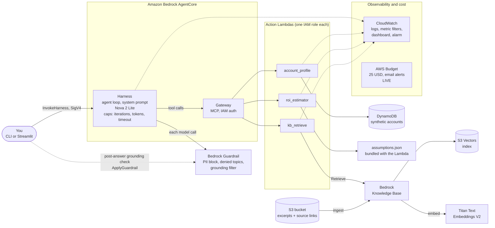

# Architecture (draft v1, updated as we build)

Renders on GitHub. In VS Code, install the "Markdown Preview Mermaid Support" extension to preview it.

## One request, step by step

1. You ask the CLI: "Prepare me for a meeting with Northwind Logistics" (a fictional company).
2. The CLI calls `InvokeHarness`, signed with your AWS credentials. Only IAM principals allowed to invoke this harness get in.
3. The harness runs the agent loop: the model reads the system prompt and decides which tools to call. Every model call passes through the Guardrail (PII and denied topics).
4. Tool calls go to the Gateway, which invokes the right Lambda: the account profile, the knowledge base lookup, the 3-year ROI estimate.
5. The model assembles the structured brief from those results: account summary, pain points, 8-10 discovery questions, first-workload architecture, ROI with assumptions, risks.
6. The client optionally runs a grounding check (`ApplyGuardrail`) comparing the answer with the tool results, and reports pass or fail.

## Identities (who may do what)

| Identity | Allowed to | Phase |
|---|---|---|
| `chirayu-admin` (you, via `aws login`) | Deploy everything. Admin, sandbox only. | done |
| Lambda role: `account_profile` | Read one DynamoDB table; write its own logs | 2 |
| Lambda role: `roi_estimator` | Write its own logs only | 2 |
| Lambda role: `kb_retrieve` | Call `Retrieve` on one knowledge base; write its own logs | 3 (applied) |
| Knowledge Base service role | List the docs bucket and read `docs/*`; call the Titan V2 model; five S3 Vectors actions on the one index | 3 (applied) |
| Gateway service role | Invoke exactly the three Lambdas | 4 |
| Harness execution role | Invoke the one model profile; apply the one guardrail; invoke the one gateway; write logs and traces | 4 |

Exact action names are verified against AWS docs at build time, not from memory.

## Terraform layout

| Stack or module | Holds | Phase |
|---|---|---|
| `infra/bootstrap` + `modules/budget` | The cost alarm. Own state; survives `make destroy` | 1 (applied) |
| `modules/storage_data` | DynamoDB table with seed data (applied); S3 docs bucket (Phase 3) | 2 (applied), 3 |
| `modules/lambda_function` | Reusable unit: one function + its own role + log group with retention; called once per tool | 2 (applied for 2 of 3 tools) |
| `infra/main` | The main stack that wires the modules together and refuses to plan without the budget | 2 (applied) |
| `modules/knowledge_base` | Docs bucket + files, S3 Vectors bucket + index, service role, Knowledge Base, data source (applied; ingest with `make ingest`) | 3 (applied) |
| `modules/guardrails` | PII, denied topics, grounding filter | 4 |
| `modules/agent` | Gateway, 3 targets, harness, roles | 4 |
| `modules/monitoring` | Metric filters, dashboard, alarm | 4 |

## Known gaps and open items

- **Grounding check is partial.** Guardrails' grounding filter needs a tagged source and query, and does not support conversational use, so it cannot run automatically inside the harness. The client and evaluation script run it after the fact instead.
- **Off-topic blocking is a deny-list.** Guardrails can block listed topics, not allow only one topic. The system prompt and the evaluation cover the rest.
- **Open:** whether the harness stream exposes tool results (needed for the grounding check). To be tested in Phase 4.
