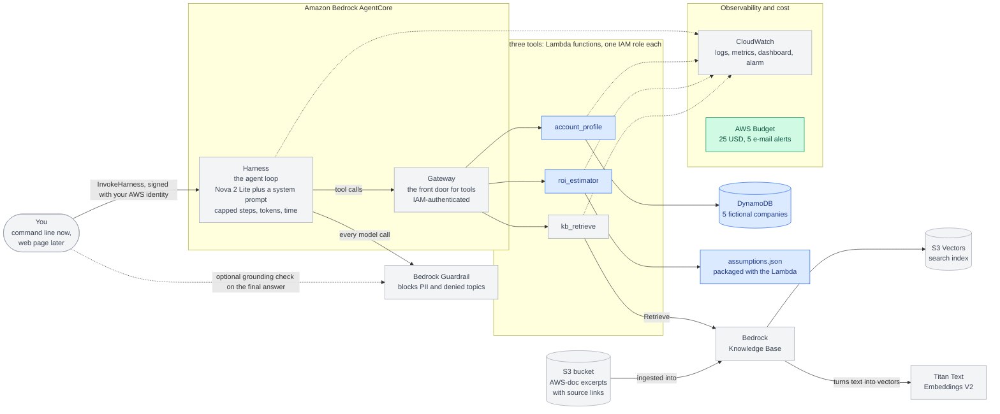
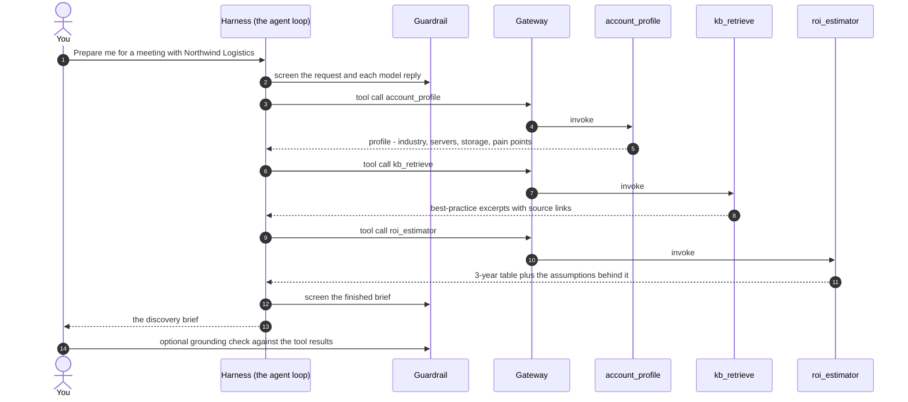

# Discovery Brief & ROI Agent: project overview

A plain-English guide to what we are building, why, and how the pieces fit together.
Read it top to bottom once; after that, use the headings as a reference.

**Reading tips.** In VS Code press `Ctrl+Shift+V` to preview this file. The diagrams use Mermaid, which needs the
"Markdown Preview Mermaid Support" extension; every Mermaid diagram has a plain-text version next to it, so you lose nothing without it.

**Status key used throughout:**
- **LIVE**: running in AWS now.
- **BUILT**: code written and tested on the laptop; waiting for the deploy approval.
- **PLANNED**: designed, not yet built.

*(Status as of 2026-10-07: the budget alarm is LIVE; the account lookup and ROI tools are BUILT; everything else is PLANNED.)*

---

## 1. The idea in one minute

Before a first meeting with a customer, a solutions architect or sales engineer normally spends hours researching:
who is this company, what do they run today, what will they worry about, what should I ask, what could moving to the
cloud save them, and what could go wrong?

This project is an **AI agent that does that preparation in about a minute.** You give it a company name; it returns a
**discovery brief**:

1. **Account summary:** who they are and what their IT estate looks like.
2. **Likely pain points:** drawn from the account data and best-practice guidance.
3. **8 to 10 discovery questions** to ask in the meeting.
4. **A proposed first-workload architecture:** the sensible first thing to move, and how.
5. **A 3-year ROI estimate**, with every assumption printed next to the number.
6. **Risks** to raise before the customer does.

All company data is **synthetic** (five fictional companies). Nothing here touches real customer information.

## 2. Why we are building it (the intent)

There are two intents, and both matter.

**The product intent.** Show what a safe, cheap, honest AI assistant for pre-sales looks like. "Honest" is the key word.
The numbers come from code, not from the model's imagination. Advice comes from retrieved AWS documentation with
source links, not from memory. When the agent doesn't know something, it says so.

**The career intent.** This is a portfolio piece for AWS Solutions Architect and Customer Solutions Manager roles.
It is designed so that every decision can be explained and defended in an interview: why this service, what else
was considered, what it costs, how it is secured, and what would change the answer. The learning material lives in
[docs/learning/](learning/README.md) and [LEARNING_NOTES.md](../LEARNING_NOTES.md).

**The constraints we chose on purpose:**
- Total spend for the whole build **under $25**, with a budget alarm created *first*.
- **Pay-per-use only.** Nothing that bills by the hour while idle, so forgetting to shut down costs cents, not dollars.
- **Least privilege.** Every function and the agent gets only the permissions it needs, each explained in a comment.
- **Everything as code** (Terraform), so it can be reviewed, repeated and deleted with one command (`make destroy`).

---

## 3. What it produces: a worked example

Asked about *Northwind Logistics* (fictional: 4,200 employees, 340 servers, 180 TB, $3.9M a year on infrastructure,
12% annual growth), the **ROI tool** (already built and tested) returns, with today's assumptions:

| | 3-year on-prem | 3-year AWS | Savings | ROI | Breakeven |
|---|---|---|---|---|---|
| Northwind Logistics | $13,160,160 | $7,768,676 | $5,391,484 | 69.4% | Year 1 |

The tool also returns the five assumptions it used, each with a value, unit, rationale and source, for example
*"a 4 vCPU / 16 GiB server on a 1-year reserved instance costs $1,168 a year (AWS Price List, 2026-10-07)"* and
*"40% of today's bill never goes away (staff, licences, network); this is a judgement call, validate with the customer"*.

The honest part: that ROI moves from about 26% to about 104% as the "retained cost" assumption moves from 60% to 30%.
The brief is meant to show that sensitivity, not hide it. And if AWS would cost more, the tool reports negative savings and no breakeven.

---

## 4. Features

| Feature | What it does | Status |
|---|---|---|
| **Account profile lookup** | Finds a company by name (case and spacing tolerant) in a DynamoDB table; returns an explicit "not found" instead of inventing data | BUILT |
| **3-year ROI / TCO estimator** | Pure-Python model comparing staying on-prem with moving to AWS; assumptions in a config file and shown in every answer | BUILT |
| **Best-practice knowledge base** | Semantic search over short AWS-doc excerpts, returning passages with source links | PLANNED (Phase 3) |
| **The agent** | A managed loop (Amazon Bedrock AgentCore) that reads your request, decides which tools to call, and assembles the brief | PLANNED (Phase 4) |
| **Guardrails** | Blocks personal data (PII) in outputs and denies off-topic requests; a post-answer grounding check | PLANNED (Phase 4) |
| **Monitoring** | Log retention, error and latency metrics, a dashboard, an alarm | PLANNED (Phase 4) |
| **Cost controls** | $25 budget with 5 alerts; hard caps on agent steps, tokens and time | Budget LIVE; caps PLANNED |
| **Evaluation script** | 10+ test prompts (PII-elicit, off-topic, fabrication-bait, prompt-injection) with pass/fail | PLANNED (Phase 5) |
| **Clients** | A command-line client, optionally a Streamlit web page | PLANNED (Phase 4/6) |
| **Infrastructure as code** | Terraform stacks and modules; `make plan / apply / destroy` | Budget stack LIVE; main stack BUILT |
| **Unit tests** | 79 tests (moto fake AWS), plus a post-deploy smoke test | BUILT |

---

## 5. The architecture

### 5.1 The picture

Colour key: green = LIVE, blue = BUILT (awaiting deploy), grey = PLANNED.



### 5.2 The same picture in plain text

```
                          YOU (command line now, web page later)
                                     |  InvokeHarness, signed with your AWS identity
                                     v
   +------------------------ Amazon Bedrock AgentCore -----------------------+
   |  HARNESS: the agent loop (Nova 2 Lite + system prompt, capped)          |
   |        |   every model call -----> BEDROCK GUARDRAIL (PII, denied topics)|
   |        |   tool calls                                                    |
   |        v                                                                 |
   |  GATEWAY: front door for tools, IAM-authenticated                        |
   +--------|-----------------------|-----------------------|----------------+
            v                       v                       v
     account_profile          roi_estimator            kb_retrieve        <- 3 Lambdas,
       (BUILT)                   (BUILT)                (planned)            one IAM role each
            |                       |                       |
            v                       v                       v
   DynamoDB: 5 fictional     assumptions.json        Bedrock Knowledge Base
   companies (BUILT)         (BUILT)                   |            |
                                                       v            v
                                                S3 Vectors      Titan embeddings
                                                (search index)  (text -> vectors)
                                                       ^
                                                S3 bucket: AWS-doc excerpts + links

   All Lambdas and the harness write to CLOUDWATCH (logs, metrics, dashboard, alarm).
   AWS BUDGET ($25, 5 e-mail alerts) watches the whole account.      <- LIVE
```

### 5.3 One request, step by step



1. You ask for a brief. The request is signed with your AWS identity, so only people you allow can call the agent.
2. The **harness** runs the model in a loop. The model reads its instructions and decides what it needs.
3. It asks the **account profile** tool who the customer is. If there is no such company, the tool says so plainly, and the agent must say so too.
4. It asks the **knowledge base** tool for relevant best practice, and gets short excerpts with source links.
5. It passes the company's numbers to the **ROI tool**, which does the maths in plain Python.
6. The model writes the brief from those results. Every model call passes through the **guardrail**.
7. Optionally, a grounding check compares the finished brief with the tool results and reports pass or fail.

---

## 6. The components, explained

| Component | Plain-English role | Analogy | Why this and not the alternative |
|---|---|---|---|
| **Amazon Bedrock** | AWS's service for using AI models | A switchboard to many models | One bill, IAM security, no keys to manage |
| **Nova 2 Lite** (the model) | Reads the request, calls tools, writes the brief | The analyst | About $0.05-0.06 per brief; Amazon's own models need no extra subscription. Claude Haiku 4.5 is tested against it in Phase 5 |
| **AgentCore Harness** | Runs the agent loop with limits on steps, tokens and time | A manager that stops the analyst going in circles | Bedrock Agents "Classic" is closed to new accounts (since 2026-07-30); AgentCore is its supported successor |
| **AgentCore Gateway** | Exposes our Lambdas to the agent as tools | A reception desk that checks ID | Standard tool protocol (MCP) with IAM authentication, so no custom plumbing |
| **Lambda** | Runs a small piece of code only when called | A vending machine | $0 while idle; a server would bill every hour |
| **DynamoDB** | Looks up one company by name | A filing cabinet with labelled folders | Pay per read and write; Aurora would bill hourly |
| **Knowledge Base + Titan embeddings** | Finds passages by meaning rather than keywords | A librarian who understands the question | Managed ingestion and retrieval, no servers |
| **S3 Vectors** | Stores the search index | A very cheap warehouse for the index | About $0.06 per GB-month and no hourly floor; OpenSearch Serverless would cost far more while idle |
| **Guardrails** | Blocks PII and denied topics on the way in and out | A compliance officer reading over the shoulder | Built-in, configurable, auditable |
| **CloudWatch** | Collects logs, metrics, dashboards, alarms | The CCTV room | Native to every service above |
| **AWS Budgets** | E-mails you as spending crosses 20, 50, 80 and 100% | A smoke alarm | Free; but a warning, not a brake |
| **Terraform** | Describes all of this in files and builds it | The architect's blueprint, executable | Reviewable, repeatable, one-command teardown |

---

## 7. How it is kept safe

**Identity: one badge per component, no shared master key.**

| Who | May do |
|---|---|
| You (`chirayu-admin`, MFA, short-lived `aws login` credentials) | Deploy everything. Administrator rights, **sandbox account only**. |
| `account_profile` Lambda | Read one DynamoDB table, one action (`GetItem`); write its own logs |
| `roi_estimator` Lambda | Write its own logs. Nothing else, because it calls no AWS service |
| `kb_retrieve` Lambda *(planned)* | Query one knowledge base; write its own logs |
| Knowledge Base service role *(planned)* | Read the docs bucket, call the embedding model, use the one index |
| Gateway role *(planned)* | Invoke exactly the three Lambdas |
| Harness role *(planned)* | Call the one model, apply the one guardrail, use the one gateway, write logs |

**Content safety (Phase 4):**
- **PII:** the guardrail blocks personal data in outputs, and the dataset contains none to leak.
- **Off-topic:** a deny-list of topics plus the system prompt. (Guardrails can block listed topics; they cannot say "only allow this topic".)
- **Fabrication:** the numbers come from code; advice comes from cited excerpts; "not found" is an explicit answer; the evaluation tries to trick the agent into inventing.
- **Prompt injection:** tool output is treated as data, never as instructions; the evaluation includes an attack through tool results.

**Hygiene:** no secrets in the repo (pre-commit scans for keys and credentials), the account ID and e-mail are never committed,
Terraform state is git-ignored, line endings are pinned, and every apply is reviewed from a saved plan first.

---

## 8. What it costs

- **Idle: $0.00 an hour.** Nothing in the design bills while unused (prices verified against the AWS Price List API, details in [docs/costs.md](costs.md)).
- **Per brief: about $0.05-0.06** on Nova 2 Lite (an estimate, replaced by a measurement in Phase 4). The guardrail check costs about as much as the model tokens, a good reminder that safety controls are a real line item.
- **Whole build: about $9-10 expected, about $20 with a 2x safety margin**, under the $25 ceiling. The biggest item is the Phase 5 evaluation runs.
- **Layers that enforce the ceiling:** pay-per-use design; hard caps on each agent run; tiny unit prices; the budget alarm; `make destroy`.

The budget is a **smoke alarm, not a sprinkler**: AWS refreshes it only a few times a day, so it can warn late. That is why the hard limits live in the agent itself.

---

## 9. Key decisions and trade-offs

The full table, with "what would change my mind" for each, is in [LEARNING_NOTES.md](../LEARNING_NOTES.md). The headlines:

| Decision | Instead of | Because |
|---|---|---|
| AgentCore harness and gateway | Bedrock Agents Classic | Classic is closed to new accounts |
| S3 Vectors | OpenSearch Serverless, Aurora | Pay-per-use, no hourly floor; our data is about 1 MB |
| Nova 2 Lite | Claude Haiku 4.5 | Cheaper and no subscription; measured against Haiku in Phase 5 |
| The `us.` inference profile | The `global.` profile (about 10% cheaper) | Keeps inference in US regions and lets IAM name exact regions |
| Maths in Python, not in the model | Letting the model calculate | Deterministic, testable, auditable |
| Assumptions in a file, shown in output | Hard-coded numbers | A sceptical CFO can challenge each one |
| Serverless only | EC2 or containers | $0 idle |
| Separate budget stack | One stack for everything | The alarm must exist first and outlive `make destroy` |
| Local Terraform state | S3 backend with locking | One person, one sandbox |

---

## 10. Honest limitations

- **Synthetic data.** Five fictional companies; nothing is connected to a CRM or to real customers.
- **The ROI model is deliberately simple.** No discounting, tax, risk adjustment or phased migration. Three of its five assumptions (right-sizing, migration effort, retained cost) are judgement calls that must be validated with a real customer.
- **The grounding check is only partial.** Bedrock's grounding filter needs a tagged source and doesn't support conversational use, so it can't run automatically inside the agent. We run it after the answer instead.
- **Off-topic blocking is a deny-list**, not an allow-list.
- **Language models are not deterministic.** Two runs can differ; the evaluation measures pass rates rather than promising perfection.
- **The budget warns, it doesn't stop.**
- **Model quality is unproven** until the Phase 5 evaluation compares Nova 2 Lite with Haiku 4.5.
- **Sandbox shortcuts:** one admin user, local state, a single region.

**What I would do for production:** per-person roles through IAM Identity Center; a remote Terraform state with locking; separate dev, test and production accounts with a CI/CD pipeline; budget actions plus Cost Anomaly Detection; a real CRM integration with row-level access control; private networking (VPC endpoints); encryption keys the customer controls; red-team testing and human review of output; and a proper evaluation set tracked over time.

---

## 11. Build roadmap

| Phase | Builds | Status |
|---|---|---|
| 1 | Budget alarm, tooling, sign-in | **Done, LIVE** |
| 2 | DynamoDB table, `account_profile` and `roi_estimator` Lambdas, tests, main Terraform stack | Built and tested; plan reviewed; **awaiting deploy approval** |
| 3 | Knowledge base: S3 docs bucket, S3 Vectors index, Titan embeddings, `kb_retrieve` | Planned |
| 4 | Guardrail, AgentCore gateway and harness, monitoring, command-line client | Planned |
| 5 | Evaluation script (10+ prompts), Nova 2 Lite vs Haiku 4.5 | Planned |
| 6 | README, 2-minute demo script, blog draft, one-page interview prep sheet | Planned |

---

## 12. Where things live in the repo

| Path | What is there |
|---|---|
| `infra/bootstrap/` and `infra/modules/budget/` | The budget alarm stack (LIVE) |
| `infra/main/` | The main stack: table and Lambdas now, more later |
| `infra/modules/storage_data/`, `infra/modules/lambda_function/` | Reusable Terraform modules |
| `src/lambdas/account_profile/`, `src/lambdas/roi_estimator/` | The tool code |
| `src/lambdas/roi_estimator/assumptions.json` | The ROI assumptions a CFO can read |
| `data/accounts.json` | The five fictional companies |
| `tests/` | 79 unit tests (fake AWS, no cost) |
| `scripts/` | Price verification and the post-deploy smoke test |
| `docs/costs.md` | Verified prices and the cost model |
| `docs/architecture.md` | The technical architecture draft |
| `docs/learning/` and `LEARNING_NOTES.md` | Lessons, exercises, glossary, decisions, interview Q&A |
| `Makefile` | `make plan`, `apply`, `destroy`, `smoke`, `test` |

---

## 13. Words you will hear

| Word | Meaning |
|---|---|
| **Agent** | A model that can decide to call tools and loop until it has an answer |
| **Tool** | A function the agent may call (ours are Lambdas) |
| **MCP** | Model Context Protocol, a standard way to describe tools to a model |
| **Embedding** | A list of numbers capturing a text's meaning, so similar texts sit close together |
| **RAG** | Retrieval-augmented generation: fetch relevant documents first, then answer using them |
| **Guardrail** | Configurable filters on what goes into and out of a model |
| **Grounding** | Whether an answer is supported by the supplied source material |
| **IAM role / least privilege** | A temporary badge of permissions / giving only the minimum needed |
| **Terraform plan / apply** | Preview of changes / making them real |
| **TCO / ROI** | Total cost of ownership / return on investment |
